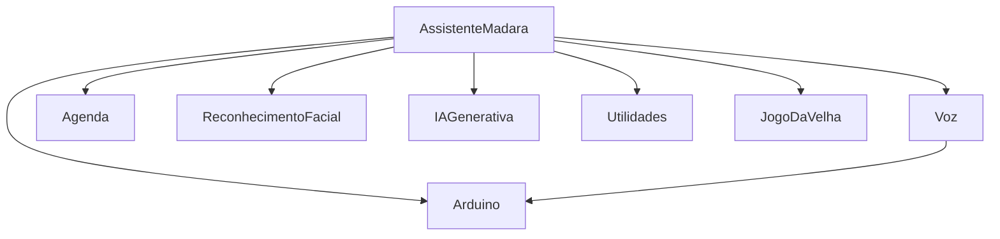

# 🤖 Projeto M.A.D.A.R.A. — Assistente Virtual por Comandos de Voz

Assistente virtual inspirada na **F.R.I.D.A.Y.** (Marvel), capaz de reconhecer
comandos de voz e executar tarefas — desde consultar a agenda até conversar com
uma **IA generativa** e reconhecer o rosto do usuário pela webcam.

> **Checkpoint 4 — 2º semestre.** Projeto acadêmico desenvolvido em Python,
> estruturado de forma **orientada a objetos** e dividido em módulos/funções.

---

## ✨ Funcionalidades

### Comandos obrigatórios (itens 1 a 9)

| # | Comando de voz | O que faz |
|---|----------------|-----------|
| 1 | **"madara"** (palavra de ativação) | Nenhum comando é executado sem falar o nome antes. Sem ele, o texto é apenas impresso na tela. |
| 2 | **"madara cadastrar evento na agenda"** | Pergunta o evento e grava em `agenda.txt`. |
| 3 | **"madara ler agenda"** | Lê em voz alta todos os eventos cadastrados. |
| 4 | **"madara que horas são?"** | Fala a hora atual. |
| 5 | **"madara que dia é hoje?"** | Fala a data atual por extenso. |
| 6 | **"madara calcular 5 mais 3"** | Faz as 4 operações básicas (aceita símbolos e palavras). |
| 7 | **"madara reconhecer face"** / **"madara quem sou eu?"** | Abre a webcam e reconhece a pessoa (modelo Eigenfaces pré-treinado). |
| 8 | **"madara limpar agenda"** | Apaga os eventos **sem excluir** o arquivo `agenda.txt`. |
| 9 | **"madara <qualquer pergunta>"** | Encaminha para a **IA generativa** (Groq na nuvem ou Ollama local). |

### Comandos extras (item 10)

- 💵 **"madara qual o valor do dólar?"**
- 🪙 **"madara quanto vale um bitcoin?"**
- 🌦️ **"madara previsão do tempo para São Paulo"**
- 🔎 **"madara pesquisar por ..."** (Google)
- ▶️ **"madara abrir youtube sobre ..."**
- 🎓 **"madara abrir portal da faculdade"**
- 🖼️ **"madara tirar print da tela"**
- 🔊 **"madara aumentar volume"** / **"madara diminuir volume"**
- ⭕ **"madara jogo da velha"** (jogado por voz contra a assistente)
- 🛑 **"madara desligar"** (encerra a assistente)

### Boneco com Arduino

- 👁️ **Olhos acesos** — os dois LEDs acendem sempre que o MADARA fala, em
  sincronia com o áudio
- 🌀 **"madara hashirama"** — a cabeça do boneco balança de um lado para o
  outro enquanto o MADARA fala, em personagem, sobre acabar com o clã Senju
- 🔴 **"madara ativar sharingan"** — só o LED vermelho acende, a cabeça balança
  e ele anuncia o *Mangekyou Sharingan*
- 🔵 **"madara ativar rinnegan"** — só o LED azul acende, a cabeça balança e
  ele anuncia o *Rinnegan do Sábio dos Seis Caminhos*

O Sharingan e o Rinnegan precisam do verbo **"ativar"**: uma pergunta como
*"madara, quem tem o sharingan?"* continua indo para a IA.

Detalhes de montagem em [Integração com o Arduino](#-integração-com-o-arduino), e
as peças impressas em 3D em [Modelos 3D do boneco](#-modelos-3d-do-boneco).

---

## 🗂️ Estrutura do projeto

```
Projeto_FRIDAY/
├── madara.py                     # Programa principal (classe AssistenteMadara)
├── capturar_rostos.py            # Script: captura amostras de rosto na webcam
├── treinar_modelo.py             # Script: treina o modelo Eigenfaces (.yml)
├── testar_arduino.py             # Script: testa olhos e cabeça do boneco
├── requirements.txt              # Dependências do projeto
├── .env.example                  # Modelo de configuração (copie para .env)
├── .env                          # 🔒 suas chaves        (fora do repositório)
├── agenda.txt                    # Eventos cadastrados   (fora do repositório)
├── classificadoreigen.yml        # Modelo treinado       (fora do repositório)
├── fotos/                        # Amostras de rosto     (fora do repositório)
├── arduino/
│   └── madara_arduino/
│       └── madara_arduino.ino    # Sketch da placa (olhos + cabeça)
├── modelos3d/                    # Peças do boneco para impressão 3D (.stl / .f3d)
└── modulos/                      # Pacote com as classes da assistente
    ├── __init__.py
    ├── config.py                 # Leitura das chaves (.env / variáveis de ambiente)
    ├── cv_utils.py               # OpenCV com caminhos acentuados (Windows)
    ├── voz.py                    # Classe Voz  (ouvir e falar)
    ├── agenda.py                 # Classe Agenda
    ├── reconhecimento_facial.py  # Classe ReconhecimentoFacial
    ├── ia_generativa.py          # Classe IAGenerativa (Groq / Ollama)
    ├── utilidades.py             # Classe Utilidades (hora, data, cálculo, cotações...)
    ├── jogo_da_velha.py          # Classe JogoDaVelha
    └── arduino.py                # Classe Arduino (porta serial)
```

Cada funcionalidade está isolada em **uma classe própria** e o código é dividido
em funções pequenas e comentadas.

---

## 🧩 Arquitetura (Orientação a Objetos)

O programa segue o princípio de **composição**: a classe central
`AssistenteMadara` reúne um objeto de cada módulo e apenas **roteia** os
comandos de voz para a classe responsável.



Repare na seta `Voz → Arduino`: a `Voz` recebe o mesmo objeto `Arduino` no
construtor. É assim que os olhos acendem em **toda** fala — inclusive as do
jogo da velha, que usa a `Voz` diretamente — sem que nenhuma outra classe
precise lembrar de acendê-los.

---

## 🛠️ Instalação

### 1. Pré-requisitos
- **Python 3.10 ou superior** (o `numpy>=2.1` não roda em versões anteriores)
- **Webcam** (para o reconhecimento facial)
- **Microfone** (para os comandos de voz)

### 2. Clonar o repositório
```bash
git clone https://github.com/Natan-TI/Projeto_FRIDAY.git
cd Projeto_FRIDAY
```

### 3. Criar e ativar um ambiente virtual

> ⚠️ **A pasta `.venv` NÃO é portátil entre sistemas.** Ela guarda caminhos
> absolutos da máquina onde foi criada. Se você copiar o projeto do Windows
> para o macOS (ou o contrário), **apague a `.venv` e crie uma nova** — senão
> nada funciona, mesmo com o `requirements.txt` correto.

**Windows**
```bash
python -m venv .venv
.venv\Scripts\activate
pip install -r requirements.txt
```

**macOS**

No macOS o `PyAudio` precisa da biblioteca nativa `portaudio` para compilar, e
o `numpy>=2.1` exige Python 3.10+. Instale tudo pelo Homebrew antes:

```bash
brew install python@3.13 portaudio flac
python3.13 -m venv .venv
source .venv/bin/activate
pip install -r requirements.txt
```

> **Por que o `flac`?** Para enviar o áudio ao Google, o `SpeechRecognition`
> converte a gravação para FLAC. Sem um `flac` instalado, ele usa uma cópia
> embutida que só existe para processadores Intel, e em Macs com chip Apple
> sem Rosetta a assistente cai com `Bad CPU type in executable` na primeira
> vez que tenta entender uma fala.

**Linux**
```bash
sudo apt install portaudio19-dev python3-dev
python3 -m venv .venv
source .venv/bin/activate
pip install -r requirements.txt
```

> **Windows + PyAudio:** se `pip install PyAudio` falhar, instale via
> `pip install pipwin` e depois `pipwin install pyaudio`, ou baixe o *wheel*
> compatível com a sua versão do Python.

### 4. Permissões no macOS

O macOS bloqueia acesso a hardware por padrão. Na primeira execução ele pede
autorização para o app que estiver rodando o Python (Terminal ou VS Code).
Se você negar sem querer, libere em **Ajustes do Sistema › Privacidade e
Segurança**:

| Permissão | Necessária para |
|-----------|-----------------|
| Microfone | todos os comandos de voz |
| Câmera | reconhecimento facial (item 7) |
| Gravação de Tela | `"madara tirar print da tela"` |
| Acessibilidade | `"madara aumentar/diminuir volume"` |

Depois de liberar, **reinicie o app** — o macOS só aplica a permissão no
próximo start.

---

## 🔑 Configuração da IA generativa (item 9)

A assistente já vem configurada para usar a **Groq** (gratuita e rápida na nuvem).

1. Crie uma conta e gere uma chave em <https://console.groq.com>.
2. Copie o modelo de configuração e preencha com a **sua** chave:

```bash
cp .env.example .env
```

3. Abra o `.env` e substitua o valor de `GROQ_API_KEY`.

> 🔒 O `.env` está no `.gitignore` e **nunca** deve ser enviado ao GitHub.
> Se uma chave vazar num commit, apagar o arquivo depois **não resolve** — ela
> continua no histórico e precisa ser revogada no painel da Groq.

Alternativamente, dá para usar uma variável de ambiente do sistema:

```bash
# Windows (PowerShell)
setx GROQ_API_KEY "sua_chave_aqui"

# Linux / macOS
export GROQ_API_KEY="sua_chave_aqui"
```

### Alternativa: Ollama (100% local, sem internet)
1. Instale o [Ollama](https://ollama.com) e baixe um modelo:
   ```bash
   ollama pull llama3.2:3b
   ```
2. Em `madara.py`, troque o provedor:
   ```python
   self.ia = IAGenerativa(provedor="ollama")
   ```

---

## 🗣️ Voz de personagem (grave/sombria, estilo Madara Uchiha)

O MADARA fala com uma **voz grave e ameaçadora** usando o **edge-tts** (o
Text-to-Speech do Microsoft Edge) — **gratuito e sem chave de API**. O truque é
usar uma voz masculina em PT-BR e **abaixar o tom (pitch)** e a velocidade.

- **Não precisa configurar nada** para funcionar (só ter internet, que o
  edge-tts usa para gerar o áudio).
- Se quiser deixar mais grave ou mais lenta, ajuste no arquivo `.env`
  (copie o `.env.example`):

  ```
  EDGE_VOICE=pt-BR-AntonioNeural   # voz masculina PT-BR
  EDGE_PITCH=-40Hz                 # mais negativo = mais grave/assustador
  EDGE_RATE=-15%                   # mais negativo = mais lento/pesado
  ```

- Sem internet, a assistente cai automaticamente na **voz padrão do sistema**
  (pyttsx3), sem travar. No macOS isso usa o sintetizador da Apple; no Windows,
  o SAPI5.

---

## 👤 Preparando o reconhecimento facial (item 7)

> ⚠️ **O modelo treinado e as fotos NÃO vêm no repositório** (ver
> [Arquivos fora do controle de versão](#-arquivos-fora-do-controle-de-versão)).
> Depois de clonar, é obrigatório refazer os passos abaixo.

1. **Capturar rostos** — repita para cada integrante:
   ```bash
   python capturar_rostos.py
   ```
   Digite o nome, encare a webcam e pressione **`f`** para salvar cada amostra
   (até 50). Varie o ângulo, a expressão e, se der, a iluminação — o Eigenfaces
   é sensível a isso, então variedade nas fotos vale mais que quantidade.

2. **Ajustar os nomes/ids** em **dois lugares**, que precisam bater entre si:
   - `MAPA_IDS`, em `treinar_modelo.py` — a chave é o trecho do nome do
     arquivo antes do `_`. Maiúsculas e acentos **não** importam: a busca
     normaliza os dois ("Gustavo", "gustavo" e "GUSTAVO" dão no mesmo id)
   - `self.nomes`, em `modulos/reconhecimento_facial.py`

   Se esquecer de um dos dois, o treino avisa no terminal em vez de rotular a
   pessoa silenciosamente como "Desconhecido".

3. **Treinar o modelo** (gera o `classificadoreigen.yml`):
   ```bash
   python treinar_modelo.py
   ```

### Ajustando a precisão

O `limite_confianca` (em `modulos/reconhecimento_facial.py`) é o que decide
entre reconhecer a pessoa e responder "Desconhecido". No Eigenfaces, **quanto
menor o valor, melhor a correspondência** — então o limiar é um teto:

- **muito baixo** → o sistema chama gente cadastrada de "Desconhecido"
- **muito alto** → o sistema dá o nome de alguém a estranhos

A janela da webcam mostra o número ao lado do nome. Observe quanto dá quando
acerta e quanto dá quando erra, e ponha o limiar entre os dois valores.

> **Sobre a classe "Desconhecido" sugerida no enunciado:** ela ajuda pouco
> sozinha. O Eigenfaces não aprende o conceito de "estranho" — ele só decora os
> rostos que você mostrar. Medindo com 4 pessoas, uma única pessoa na classe 0
> rejeitou ~50% dos estranhos (cara ou coroa); com duas, ~66%. Vale mais pela
> **variedade** de pessoas do que pela quantidade de fotos. Quem realmente
> decide a rejeição é o `limite_confianca`.

---

## 🤖 Integração com o Arduino

O boneco tem dois LEDs nos olhos e um motor DC na cabeça, ligado por uma
ponte H. Tudo é controlado por um Arduino Uno conectado ao computador pelo
cabo USB.

### Montagem

| Componente | Pino do Arduino | Ligação |
|---|---|---|
| Ponte H — ENA | **3** | velocidade do motor (PWM) |
| Ponte H — IN1 | **4** | sentido do giro |
| Ponte H — IN2 | **5** | sentido do giro |
| Motor da cabeça | — | nos terminais **OUT1** e **OUT2** da ponte H |
| LED vermelho (Sharingan) | **9** | pino → resistor 220 Ω → LED (perna longa) → LED (perna curta) → GND |
| LED azul (Rinnegan) | **10** | igual ao vermelho |

> **Os olhos precisam de pinos com PWM** para acender gradualmente. No Uno só
> os pinos 3, 5, 6, 9, 10 e 11 têm PWM; o 3 e o 5 já são da ponte H. O 9 e o
> 10 usam o mesmo timer, então os dois olhos brilham exatamente iguais.

> **ENA:** o módulo de ponte H costuma vir com um *jumper* no ENA, que deixa o
> motor sempre na velocidade máxima. Ele precisa ser **retirado** para o pino 3
> controlar a velocidade.

> **Alimentação:** o motor deve ser alimentado pela entrada de força da ponte H
> (pilhas ou fonte), não pelo 5V do Arduino. O **GND da fonte, da ponte H e do
> Arduino precisam estar ligados entre si** — sem esse terra em comum, os
> sinais dos pinos 3, 4 e 5 não chegam à ponte H e o motor não responde.

### Como a cabeça vai e volta com um motor DC

Diferente de um servo, um motor DC não sabe em que posição está: ele só gira
para um lado ou para o outro. Por isso o sketch **estima a posição pelo
tempo**: se o motor ficou 300 ms girando para a direita, a cabeça está "300 ms
à direita" do centro. Com isso ela oscila em volta do centro e, ao parar, gira
de volta o tempo necessário para ficar de frente.

Os ajustes ficam no começo do sketch:

| Constante | Padrão | O que faz |
|---|---|---|
| `VELOCIDADE_CABECA` | 200 | Velocidade de 0 a 255. Se o motor só zumbir sem girar, aumente. |
| `AMPLITUDE_GIRO_MS` | 600 | Tempo do centro até cada lado. Maior = a cabeça vira mais. |
| `PAUSA_INVERSAO_MS` | 120 | Freio antes de inverter o sentido, para poupar as engrenagens. |

É uma estimativa: a inércia do motor acumula um pequeno erro a cada parada.
Se depois de muito uso a cabeça estiver "fugindo" do centro, desligue e
recentralize-a com a mão.

### O balanço da cabeça (Hashirama, Sharingan e Rinnegan)

Dar voltas com a cabeça torceria os fios dentro do boneco. Por isso, nas três
cenas do boneco, a cabeça só **balança**: centro → direita → esquerda →
centro, com uma pausa breve, e de novo — como um "não, não" de cabeça.

Isso é feito pelo Python (`Arduino.cabeca_balancando`), com o mesmo sketch: em
vez de deixar a cabeça ir até os 600 ms do `AMPLITUDE_GIRO_MS`, o Python manda
o sketch inverter o sentido bem antes. O tamanho do balanço é o tempo de motor
ligado do centro até cada lado, ajustável no `.env`:

```
ARDUINO_BALANCO_MS=60
```

O padrão é **60 ms**, testado no boneco do grupo: balanço visível sem forçar
os fios. Ele vale para as três cenas (Hashirama, Sharingan e Rinnegan).

A cada gesto a cabeça para no centro. Isso impede que pequenos atrasos do USB
se acumulem e façam o balanço "andar" para um lado durante uma fala longa.

### Enviando o sketch para a placa

1. Abra `arduino/madara_arduino/madara_arduino.ino` no Arduino IDE.
2. Em **Ferramentas › Placa**, escolha *Arduino Uno*; em **Porta**, a porta USB.
3. Clique em **Carregar**.

> **Mac com chip Apple (M1 em diante):** o compilador e o gravador que o
> Arduino IDE usa para placas AVR só existem para processadores Intel, e o
> carregamento falha com `bad CPU type in executable`. Até o macOS 26 basta
> instalar o Rosetta (`softwareupdate --install-rosetta --agree-to-license`).
> A partir do macOS 27 o Rosetta não é mais oferecido: carregue o sketch por um
> computador com Windows ou Intel. Só é preciso carregar uma vez — depois disso
> a placa funciona ligada em qualquer computador, porque a conversa com o
> Python pelo USB não depende dessas ferramentas.

### Testando sem a assistente

Com o sketch carregado e o **Monitor Serial do Arduino IDE fechado** (só um
programa usa a porta por vez):

```bash
python testar_arduino.py        # ajusta o tamanho do balanço com vocês
python testar_arduino.py 80     # balança direto com 80 ms por lado
```

O script acende só o LED vermelho, depois só o azul e depois os dois — para
conferir a fiação — e então balança a cabeça. Sem argumento,
ele começa com um balanço bem pequeno (30 ms) e, a cada tentativa, pergunta se
está bom: Enter balança mais, `m` balança menos, `s` confirma. No fim, mostra a
linha para gravar no `.env` (`ARDUINO_BALANCO_MS=...`).

Se ele não achar a placa, lista as portas disponíveis — copie a certa para
`ARDUINO_PORTA` no `.env`.

### Como o Python conversa com a placa

O protocolo é o mesmo do exemplo `arduino_serial.ino` visto em aula: **um
caractere por comando, a 9600 baud**.

| Caractere | Ação |
|---|---|
| `O` | acende os olhos |
| `o` | apaga os olhos |
| `G` | começa a girar a cabeça (vai e volta) |
| `P` | para e devolve a cabeça ao centro |
| `V` | acende só o LED vermelho (Sharingan) |
| `A` | acende só o LED azul (Rinnegan) |

Duas diferenças em relação ao exemplo da aula:

- **Handshake em vez de `sleep(2)`.** Abrir a porta serial reinicia o Arduino,
  e o que chega nos primeiros ~2 s se perde. Em vez de esperar um tempo fixo,
  o sketch envia `PRONTO v2` ao ligar e o Python espera essa mensagem. O `v2`
  indica que a placa sabe acender cada LED sozinho; com um sketch antigo, que
  manda só `PRONTO`, o Sharingan e o Rinnegan acendem os dois LEDs e o
  terminal avisa para carregar a versão nova.
- **Sketch sem `delay()`.** Enquanto a cabeça gira, a placa precisa continuar
  ouvindo a serial para obedecer o `o` e o `P` na hora. Cada movimento é
  controlado por `millis()`, então nada bloqueia.

Por segurança, se o Python travar sem mandar `P`, a cabeça para sozinha
depois de 30 segundos. E ao encerrar a assistente (inclusive com Ctrl+C), o
boneco volta ao repouso: olhos apagados e cabeça no centro.

---

## ▶️ Como executar

```bash
python madara.py
```

Fale, por exemplo:
- *"madara, que horas são?"*
- *"madara cadastrar evento na agenda"* → *"reunião amanhã às 10 horas"*
- *"madara ler agenda"*
- *"madara calcular 12 vezes 8"*
- *"madara quem sou eu?"*
- *"madara quanto vale um bitcoin?"*
- *"madara jogo da velha"*
- *"madara hashirama"* (com o boneco conectado)
- *"madara ativar sharingan"* / *"madara ativar rinnegan"*
- *"madara desligar"*

O Arduino é **opcional**: sem a placa, a assistente avisa no terminal e
funciona normalmente, só sem os efeitos físicos.

---

## 🧱 Modelos 3D do boneco

As peças do boneco foram modeladas no **Fusion 360** e impressas em 3D. Os
arquivos ficam na pasta `modelos3d/`:

| Arquivo | O que é | Tamanho |
|---|---|---|
| `01_Tronco_suporte_TT.stl` | Corpo em forma de cúpula, com o suporte do motor TT (o motor da cabeça) e a abertura por onde passa o pescoço | 155 × 133 × 88 mm |
| `02_Cabeca_cabelo_pescoco.stl` | Cabeça com o cabelo espetado do Madara e o pescoço, que encaixa no tronco | 86 × 77 × 106 mm |
| `03_Tampa_inferior.stl` | Base que fecha o tronco por baixo — **não usada** (ver abaixo) | 150 × 130 × 8 mm |
| `Madara_Maker_cp2.stl` | O boneco montado num único arquivo, para visualizar o conjunto | 155 × 177 × 133 mm |
| `Madara_Maker_CP2.f3d` | Projeto editável no Fusion 360, de onde saem as peças | — |

As peças para imprimir são as numeradas (`01` a `03`). O GitHub mostra os
arquivos `.stl` em 3D direto no navegador — é só clicar neles.

> **Tampa inferior não usada:** a `03_Tampa_inferior.stl` deu problema na
> impressão e ficou de fora do boneco final. O arquivo continua no
> repositório para quem quiser reimprimi-la e fechar a base.

---

## 🚫 Arquivos fora do controle de versão

Alguns arquivos ficam **de fora do repositório** de propósito. Depois de
clonar, é normal que eles não existam — o passo a passo acima os recria.

| Arquivo / pasta | Por que não vai para o GitHub |
|---|---|
| `.env` | Contém a chave da API. Uma chave em commit fica no histórico para sempre. |
| `classificadoreigen.yml` | Arquivo **gerado** — recrie com `python treinar_modelo.py`. Confirmado com o professor que não precisa ir no repositório. Também costuma passar do limite de 100 MB por arquivo do GitHub. |
| `fotos/` | Imagens biométricas de pessoas reais e identificáveis. Não devem ser publicadas sem o consentimento de cada uma. |
| `.venv/` | Guarda caminhos absolutos da máquina. Cada pessoa cria a sua. |
| `agenda.txt` | Dado de uso, não código. |
| `assets/` | Material de apoio do professor (enunciado e exemplos de aula). |
| `.DS_Store`, `__pycache__/` | Lixo do sistema operacional e cache do Python. |

---

## ✅ Checklist dos critérios avaliativos

- [x] **Itens 1 a 9** implementados, código dividido em funções e comentado.
- [x] **Mais de 2 comandos extras** (item 10): dólar, bitcoin, tempo, Google,
      YouTube, print, volume, portal, jogo da velha — e, com o boneco,
      Hashirama, Sharingan e Rinnegan.
- [x] **Orientação a objetos** com várias classes (`AssistenteMadara`, `Voz`,
      `Agenda`, `ReconhecimentoFacial`, `IAGenerativa`, `Utilidades`,
      `JogoDaVelha`, `Arduino`).
- [x] **Boneco físico**: Arduino com olhos de LED e cabeça motorizada, e peças
      impressas em 3D.
- [x] **Documentação** completa com dependências e instruções de instalação.

---

## 👥 Integrantes do grupo

| Nome | RM |
|------|----|
| Natan Eguchi dos Santos | RM98720 |
| João Pedro Marques Rodrigues | RM98307 |
| Gustavo Henrique Santos Bonfim | RM98864 |
| Kayky Paschoal Ribeiro | RM99929 |
| Lucas Yuji Farias Umada | RM99757 |

---

## 📚 Tecnologias utilizadas

- **SpeechRecognition** — reconhecimento de fala (Google Speech API)
- **edge-tts** — síntese de voz de personagem (grave/sombria), gratuita
- **pyttsx3** — síntese de voz offline (fallback quando falta internet)
- **pygame** — reprodução do áudio gerado pelo edge-tts
- **OpenCV (opencv-contrib-python)** — detecção e reconhecimento facial (Eigenfaces)
- **Groq / Ollama** — IA generativa (LLMs)
- **requests** — cotações, clima e integração HTTP
- **pyautogui** — automação de sistema (print e volume)
- **pyserial** — comunicação com o Arduino pela porta USB
- **Arduino Uno + ponte H + motor DC** — olhos (LEDs com fade por PWM) e cabeça do boneco
- **Fusion 360 + impressão 3D** — corpo e cabeça do boneco
