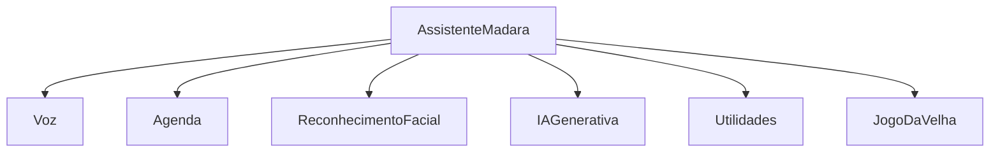

# 🤖 Projeto M.A.D.A.R.A. — Assistente Virtual por Comandos de Voz

Assistente virtual inspirada na **M.A.D.A.R.A.** (Marvel), capaz de reconhecer
comandos de voz e executar tarefas — desde consultar a agenda até conversar com
uma **IA generativa** e reconhecer o rosto do usuário pela webcam.

> **Checkpoint 4 — 2º semestre.** Projeto acadêmico desenvolvido em Python,
> estruturado de forma **orientada a objetos** e dividido em módulos/funções.

---

## ✨ Funcionalidades

### Comandos obrigatórios (itens 1 a 9)

| # | Comando de voz | O que faz |
|---|----------------|-----------|
| 1 | **"madara"** (palavra de ativação) | Nenhum comando é executado sem falar o nome antes. Sem ele, o texto é apenas impresso na tela. |
| 2 | **"madara cadastrar evento na agenda"** | Pergunta o evento e grava em `agenda.txt`. |
| 3 | **"madara ler agenda"** | Lê em voz alta todos os eventos cadastrados. |
| 4 | **"madara que horas são?"** | Fala a hora atual. |
| 5 | **"madara que dia é hoje?"** | Fala a data atual por extenso. |
| 6 | **"madara calcular 5 mais 3"** | Faz as 4 operações básicas (aceita símbolos e palavras). |
| 7 | **"madara reconhecer face"** / **"madara quem sou eu?"** | Abre a webcam e reconhece a pessoa (modelo Eigenfaces pré-treinado). |
| 8 | **"madara limpar agenda"** | Apaga os eventos **sem excluir** o arquivo `agenda.txt`. |
| 9 | **"madara <qualquer pergunta>"** | Encaminha para a **IA generativa** (Groq na nuvem ou Ollama local). |

### Comandos extras (item 10)

- 💵 **"madara qual o valor do dólar?"**
- 🪙 **"madara quanto vale um bitcoin?"**
- 🌦️ **"madara previsão do tempo para São Paulo"**
- 🔎 **"madara pesquisar por ..."** (Google)
- ▶️ **"madara abrir youtube sobre ..."**
- 🎓 **"madara abrir portal da faculdade"**
- 🖼️ **"madara tirar print da tela"**
- 🔊 **"madara aumentar volume"** / **"madara diminuir volume"**
- ⭕ **"madara jogo da velha"** (jogado por voz contra a assistente)
- 🛑 **"madara desligar"** (encerra a assistente)

---

## 🗂️ Estrutura do projeto

```
projeto_madara/
├── madara.py                     # Programa principal (classe AssistenteMadara)
├── capturar_rostos.py            # Script: captura amostras de rosto na webcam
├── treinar_modelo.py             # Script: treina o modelo Eigenfaces (.yml)
├── requirements.txt              # Dependências do projeto
├── agenda.txt                    # Arquivo onde os eventos são gravados
├── classificadoreigen.yml        # Modelo facial pré-treinado (gerado no treino)
├── fotos/                        # Amostras de rosto para o treinamento
└── modulos/                      # Pacote com as classes da assistente
    ├── __init__.py
    ├── voz.py                    # Classe Voz  (ouvir e falar)
    ├── agenda.py                 # Classe Agenda
    ├── reconhecimento_facial.py  # Classe ReconhecimentoFacial
    ├── ia_generativa.py          # Classe IAGenerativa (Groq / Ollama)
    ├── utilidades.py             # Classe Utilidades (hora, data, cálculo, cotações...)
    └── jogo_da_velha.py          # Classe JogoDaVelha
```

Cada funcionalidade está isolada em **uma classe própria** e o código é dividido
em funções pequenas e comentadas.

---

## 🧩 Arquitetura (Orientação a Objetos)

O programa segue o princípio de **composição**: a classe central
`AssistenteMadara` reúne um objeto de cada módulo e apenas **roteia** os
comandos de voz para a classe responsável.



---

## 🛠️ Instalação

### 1. Pré-requisitos
- **Python 3.10 ou superior** (o `numpy>=2.1` não roda em versões anteriores)
- **Webcam** (para o reconhecimento facial)
- **Microfone** (para os comandos de voz)

### 2. Clonar o repositório
```bash
git clone https://github.com/<seu-usuario>/projeto_madara.git
cd projeto_madara
```

### 3. Criar e ativar um ambiente virtual

> ⚠️ **A pasta `.venv` NÃO é portátil entre sistemas.** Ela guarda caminhos
> absolutos da máquina onde foi criada. Se você copiar o projeto do Windows
> para o macOS (ou o contrário), **apague a `.venv` e crie uma nova** — senão
> nada funciona, mesmo com o `requirements.txt` correto.

**Windows**
```bash
python -m venv .venv
.venv\Scripts\activate
pip install -r requirements.txt
```

**macOS**

No macOS o `PyAudio` precisa da biblioteca nativa `portaudio` para compilar, e
o `numpy>=2.1` exige Python 3.10+. Instale os dois pelo Homebrew antes:

```bash
brew install python@3.13 portaudio
python3.13 -m venv .venv
source .venv/bin/activate
pip install -r requirements.txt
```

**Linux**
```bash
sudo apt install portaudio19-dev python3-dev
python3 -m venv .venv
source .venv/bin/activate
pip install -r requirements.txt
```

> **Windows + PyAudio:** se `pip install PyAudio` falhar, instale via
> `pip install pipwin` e depois `pipwin install pyaudio`, ou baixe o *wheel*
> compatível com a sua versão do Python.

### 4. Permissões no macOS

O macOS bloqueia acesso a hardware por padrão. Na primeira execução ele pede
autorização para o app que estiver rodando o Python (Terminal ou VS Code).
Se você negar sem querer, libere em **Ajustes do Sistema › Privacidade e
Segurança**:

| Permissão | Necessária para |
|-----------|-----------------|
| Microfone | todos os comandos de voz |
| Câmera | reconhecimento facial (item 7) |
| Gravação de Tela | `"madara tirar print da tela"` |
| Acessibilidade | `"madara aumentar/diminuir volume"` |

Depois de liberar, **reinicie o app** — o macOS só aplica a permissão no
próximo start.

---

## 🔑 Configuração da IA generativa (item 9)

A assistente já vem configurada para usar a **Groq** (gratuita e rápida na nuvem).

1. Crie uma conta e gere uma chave em <https://console.groq.com>.
2. Defina a chave numa **variável de ambiente** (nunca coloque a chave no código):

```bash
# Windows (PowerShell)
setx GROQ_API_KEY "sua_chave_aqui"

# Linux / macOS
export GROQ_API_KEY="sua_chave_aqui"
```

### Alternativa: Ollama (100% local, sem internet)
1. Instale o [Ollama](https://ollama.com) e baixe um modelo:
   ```bash
   ollama pull llama3.2:3b
   ```
2. Em `madara.py`, troque o provedor:
   ```python
   self.ia = IAGenerativa(provedor="ollama")
   ```

---

## 🗣️ Voz de personagem (grave/sombria, estilo Madara Uchiha)

A Madara fala com uma **voz grave e ameaçadora** usando o **edge-tts** (o
Text-to-Speech do Microsoft Edge) — **gratuito e sem chave de API**. O truque é
usar uma voz masculina em PT-BR e **abaixar o tom (pitch)** e a velocidade.

- **Não precisa configurar nada** para funcionar (só ter internet, que o
  edge-tts usa para gerar o áudio).
- Se quiser deixar mais grave ou mais lenta, ajuste no arquivo `.env`
  (copie o `.env.example`):

  ```
  EDGE_VOICE=pt-BR-AntonioNeural   # voz masculina PT-BR
  EDGE_PITCH=-40Hz                 # mais negativo = mais grave/assustador
  EDGE_RATE=-15%                   # mais negativo = mais lento/pesado
  ```

- Sem internet, a assistente cai automaticamente na **voz padrão do Windows**
  (pyttsx3), sem travar.

---

## 👤 Preparando o reconhecimento facial (item 7)

1. **Capturar rostos** (repita para cada integrante e também para
   `Desconhecido`, conforme a dica do enunciado):
   ```bash
   python capturar_rostos.py
   ```
   Encare a webcam e pressione **`f`** para salvar cada amostra.

2. **Ajustar os nomes/ids** em `treinar_modelo.py` (dicionário `MAPA_IDS`) e no
   dicionário `self.nomes` de `modulos/reconhecimento_facial.py`.

3. **Treinar o modelo** (gera o `classificadoreigen.yml`):
   ```bash
   python treinar_modelo.py
   ```

---

## ▶️ Como executar

```bash
python madara.py
```

Fale, por exemplo:
- *"madara, que horas são?"*
- *"madara cadastrar evento na agenda"* → *"reunião amanhã às 10 horas"*
- *"madara ler agenda"*
- *"madara calcular 12 vezes 8"*
- *"madara quem sou eu?"*
- *"madara quanto vale um bitcoin?"*
- *"madara jogo da velha"*
- *"madara desligar"*

---

## ✅ Checklist dos critérios avaliativos

- [x] **Itens 1 a 9** implementados, código dividido em funções e comentado.
- [x] **Mais de 2 comandos extras** (item 10): dólar, bitcoin, tempo, Google,
      YouTube, print, volume, portal, jogo da velha.
- [x] **Orientação a objetos** com várias classes (`AssistenteMadara`, `Voz`,
      `Agenda`, `ReconhecimentoFacial`, `IAGenerativa`, `Utilidades`,
      `JogoDaVelha`).
- [x] **Documentação** completa com dependências e instruções de instalação.

---

## 👥 Integrantes do grupo

| Nome | RM |
|------|----|
| Natan Eguchi dos Santos | RM98720 |
| João Pedro Marques Rodrigues | RM98307 |
| Gustavo Henrique Santos Bonfim | RM98864 |
| Kayky Paschoal Ribeiro | RM99929 |
| Lucas Yuji Farias Umada | RM99757 |

---

## 📚 Tecnologias utilizadas

- **SpeechRecognition** — reconhecimento de fala (Google Speech API)
- **edge-tts** — síntese de voz de personagem (grave/sombria), gratuita
- **pyttsx3 / gTTS + pygame** — síntese de voz (fallback offline)
- **OpenCV (opencv-contrib-python)** — detecção e reconhecimento facial (Eigenfaces)
- **Groq / Ollama** — IA generativa (LLMs)
- **requests** — cotações, clima e integração HTTP
- **pyautogui** — automação de sistema (print e volume)
